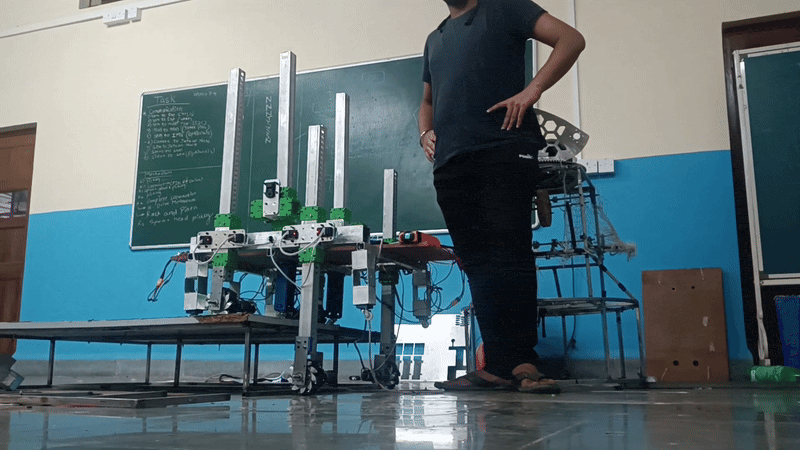

# 🤖 ROBOCON 2026 — Embedded Robot Control

<p align="center">
  <strong>A collection of embedded-control systems developed around robotic locomotion, servo mechanisms, controller interfaces, sensing, and picking mechanisms.</strong>
</p>

<p align="center">
  
  
  
  
</p>

---

## 🎥 Hardware Demo

<p align="center">
  
</p>

<p align="center">
  <sub>Physical robot and mechanism testing during the ROBOCON development cycle.</sub>
</p>

---

## 🧭 Overview

This repository preserves embedded-control experiments developed while working with **STM32 and ESP32 microcontrollers** for robotic mechanisms and competition-oriented systems.

The work progresses from individual actuator control to integrated systems involving:

- servo control,
- multi-servo coordination,
- stepper control,
- controller-driven mechanisms,
- locomotion,
- sensor-based actuation,
- and robotic picking mechanisms.

---

## 🔌 Typical Control Architecture

```text
             PS4 Controller
                    │
                    ▼
              ESP Receiver
                    │
                   UART
                    │
                    ▼
                STM32 MCU
                    │
             ┌──────┴──────┐
             ▼             ▼
          Servos        Steppers
             │             │
             └──────┬──────┘
                    ▼
             Robotic Mechanism
```

---

## 🔵 STM32 Project Set

| Project | Focus |
|---|---|
| `SERVO_UART` | Single-servo UART control |
| `MULTI_SERVO_UART` | Multi-servo UART control |
| `PS4_SERVO_CONTROLLED` | PS4 → ESP receiver → STM32 → servo |
| `PS4_PICKING_MECHANISM_CONTROLLED` | Controller-driven robotic picking |
| `SERVO_WORK_MODE` | Servo operating-mode experiments |
| `SERVO_STEPPER_INTEGRATION` | Servo + stepper integration |
| `PS4_SERVO_STEPPER_CTRL` | PS4-controlled servo and stepper system |
| `PS4_SERVO_STEPPER_LOCO_CONTROLLED` | Controller-based locomotion |
| `R1_PICKING_MECHANISM` | R1 picking-mechanism control |
| `SERVO_ANGLE_CONTROL` | Servo positioning and calibration |
| `STM_F4` | STM32F4 control experiments |

---

## 🟠 ESP32 Project Areas

The ESP32 collection includes additional work around:

- UART servo control
- multi-servo positioning
- continuous rotation
- user-controlled positioning
- ultrasonic / distance-based actuation
- PS4 controller interfaces
- stepper motor control
- servo-bus configuration

---

## ⚙️ Technical Areas

### Embedded Systems
- STM32F103
- STM32F4
- ESP32
- STM32 HAL
- STM32CubeIDE
- Embedded C
- UART communication
- peripheral / timer configuration

### Motion Control
- servo control
- multi-servo coordination
- stepper motor control
- servo + stepper integration
- locomotion
- robotic mechanism actuation

### Interfaces & Sensors
- PS4 controller input
- ESP-based receiver interfaces
- UART links
- ultrasonic sensing
- distance-based actuation

---

## 📌 Repository Role

Rather than representing one isolated firmware experiment, this repository documents the progression of embedded-control work that feeds into larger robotic systems.

---

<div align="center">

**Control the mechanism. Integrate the system. Test it on hardware.**

</div>
